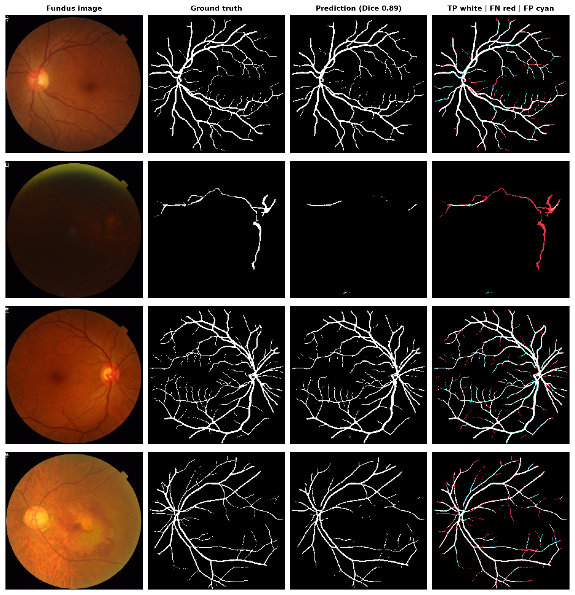

# FundusVision

**Retinal disease screening and vessel segmentation from fundus photographs.**
Two PyTorch models, one reproducible package: an ImageNet-pretrained **ResNet34** that flags an eye
as *Normal* or *Abnormal*, and a **U-Net** that traces the retinal vasculature pixel by pixel.

[](https://github.com/smurley6/fundusvision/actions/workflows/ci.yml)
[](LICENSE)


<p align="center">
  
</p>

## Results at a glance

Both numbers below are measured on **held-out test data the models never saw**. The classifier
split is grouped by patient, so no eye of a test patient appears in training (see
[Why the classifier numbers changed](#why-the-classifier-numbers-changed)).

| Task | Model | Test data | Headline metrics |
|---|---|---|---|
| Normal vs Abnormal screening | ResNet34 (21.4M params, fine-tuned) | 913 eyes / 480 patients, ODIR-5K | ROC AUC **0.817** · PR AUC 0.875 · at the validation-chosen Youden threshold: sensitivity 0.712 · specificity 0.790 · F1 0.756 · accuracy 0.747 |
| Vessel segmentation | U-Net (31.0M params, from scratch) | 200 images, Kaggle vessel set | Dice **0.819** · IoU 0.693 · pixel accuracy 0.975 |

Full metric tables, curves and error analyses: [docs/classifier.md](docs/classifier.md) ·
[docs/segmentation.md](docs/segmentation.md) · [notebooks/](notebooks/).

<p align="center">
  
</p>

## Quickstart

```bash
git clone https://github.com/smurley6/fundusvision.git && cd fundusvision
python3 -m venv .venv && source .venv/bin/activate
pip install -e ".[dev,download]"          # add CPU-only torch first if you have no GPU

# Data (Kaggle API token in ~/.kaggle/kaggle.json; ~3.5 GB total)
fundusvision download odir                # -> data/odir5k
fundusvision download vessel              # -> data/vessel_segmentation

# Train + evaluate (CUDA > Apple MPS > CPU, picked automatically)
fundusvision train-segmentation           # ~21 min on an M-series GPU
fundusvision eval-segmentation            # results/segmentation/metrics.json + docs/figures/
fundusvision train-classifier             # ~48 min on an M-series GPU
fundusvision eval-classifier              # results/classifier/metrics.json + docs/figures/
fundusvision explain                      # Grad-CAM grid

pytest                                    # unit + CPU smoke tests on synthetic data (no download needed)
```

`make help` lists the same steps as Make targets. Every command accepts `--help`.

## How it works

### Data

| Dataset | Used for | Size | Notes |
|---|---|---|---|
| [ODIR-5K](https://www.kaggle.com/datasets/andrewmvd/ocular-disease-recognition-odir5k) | classification | 6,392 fundus images from 3,358 patients | Kaggle's 512 px `preprocessed_images` + `full_df.csv` keywords |
| [Fundus vessel segmentation](https://www.kaggle.com/datasets/nikitamanaenkov/fundus-image-dataset-for-vessel-segmentation) | segmentation | 600 train + 200 test image/mask pairs at 2048 px | masks binarised at > 127 |

Images are never committed; `data/full_df.csv` (the ODIR metadata) is, so the label and split
logic can be inspected and unit-tested without a download.

### Labels and split (classifier)

Each ODIR row carries **both** eyes of a patient. `fundusvision.data.odir` melts that into one row
per physical image, labels each eye from *its own* diagnostic keywords (Normal only when the sole
meaningful keyword is `normal fundus`; capture artefacts such as `lens dust` are ignored) and
splits **by patient** with `StratifiedGroupKFold` (≈71 / 14 / 14 %). `assert_no_leakage` fails
loudly if any image path or patient ID straddles two partitions.

### Classifier

ResNet34 (ImageNet weights) → global average pool → `Linear(512,256)-BN-ReLU-Dropout(0.5)` →
`Linear(256,128)-BN-ReLU-Dropout(0.25)` → `Linear(128,1)` logit. Trained with class-weighted
`BCEWithLogitsLoss`, AdamW (lr 1e-4, wd 1e-4), cosine annealing with warm restarts, flips /
rotation / colour-jitter / affine / blur augmentation on the training split only, early stopping on
validation loss. Decision thresholds are picked on the **validation** split and frozen before touching the test
split; the headline operating point maximises Youden's J (sensitivity + specificity − 1), which
balances the two error types the way a screening tool should. A max-F1 threshold is also
reported, but F1 ignores true negatives and, with 55 % abnormal eyes, drifts to very low
thresholds.

### Segmentation

A 4-level U-Net (64-128-256-512, 1024 bottleneck, transposed-conv decoder, BatchNorm throughout)
trained from scratch at 224 px with cross-entropy and Adam (constant lr 1e-4) for 20 epochs;
the checkpoint with the best validation Dice is kept. Vessels cover ~7 % of pixels, so IoU and
Dice on the vessel class are the metrics that matter. One "obvious" addition, random flip augmentation,
*lowered* test Dice by ~0.13 on this 480-image training set, while cosine annealing made no
measurable difference; the ablation is in [docs/segmentation.md](docs/segmentation.md).

### Why the classifier numbers changed

The first version of this project reported ~84 % accuracy / 0.91 AUC. That pipeline looped over
both eyes of every CSV row, duplicating each image ~1.95× (6,392 images became "12,460 pairs"),
and then split at the row level, so roughly half of the "test" images were also in the training
set. The current pipeline deduplicates, labels per eye and groups by patient; the numbers in this
README are the leak-free ones.

## Repository layout

```
src/fundusvision/
  data/         ODIR-5K labels + patient-grouped split, vessel dataset, Kaggle downloads
  models/       FundusClassifier (ResNet backbone + MLP head), UNet
  training/     train_classifier / train_segmentation (checkpoints, history.json, split.csv)
  evaluation/   metrics, threshold selection, figures, run reports (metrics.json)
  explain/      Grad-CAM
  cli.py        `fundusvision` command-line entry point
notebooks/      01_classification.ipynb, 02_vessel_segmentation.ipynb (thin, executed walkthroughs)
docs/           model cards + figures used in this README
results/        metrics.json / history.json / config.json per run (weights are git-ignored)
tests/          unit tests + CPU end-to-end smoke tests on synthetic data (run in CI)
```

Dependencies point one way: `data` → `models` → `training` → `evaluation` → `cli`.
Adding a backbone or a dataset is a one-module change.

## Reproducibility

* Seeds are fixed (`--seed`, default 42); the exact split of every classifier run is written to
  `results/classifier/split.csv` and re-used by evaluation.
* Checkpoints are pure `state_dict`s that load under `torch.load(weights_only=True)`.
* Reported numbers were produced on an Apple M5 (MPS) with PyTorch 2.14.1; the run
  configs are in `results/*/config.json`.
* CI runs lint (`ruff`) and the full test suite on CPU for every push.

## Limitations

* Normal/Abnormal is a screening framing; "Abnormal" pools seven disease groups of very different
  visual salience. Per-disease multi-label heads are the natural next step.
* ODIR-5K comes from a small number of Chinese hospitals; no external validation (e.g. Messidor,
  EyePACS) has been done, so expect a domain shift elsewhere.
* 224 px inputs discard fine detail that matters for both tasks (microaneurysms, capillaries).
* This is a course project, not a medical device.

## Team

Georgia Tech CS 7641 Machine Learning, Fall 2025. Steven Murley (project lead), Sohum Joshi,
Adam Bakr, Yuhan Wei, Connor Smith. The original course proposal page lives at
[mlproject-blue.vercel.app](https://mlproject-blue.vercel.app); the numbers there predate the
leakage fix described above.

## Citation

See [CITATION.cff](CITATION.cff). Datasets: ODIR-5K (Peking University, 2019); Kaggle fundus vessel
segmentation dataset. Architectures: He et al., *Deep Residual Learning* (2015); Ronneberger et al.,
*U-Net* (2015); Selvaraju et al., *Grad-CAM* (2017).

## License

[MIT](LICENSE).
