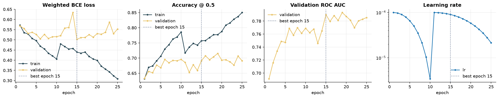
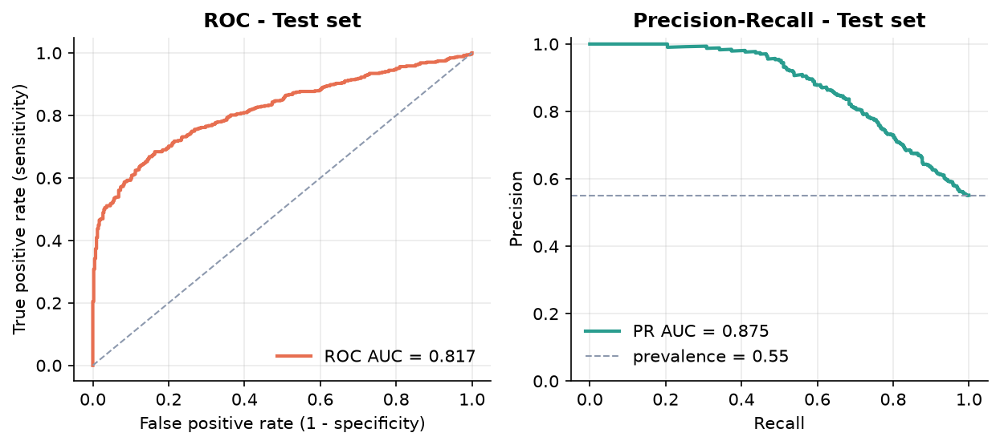
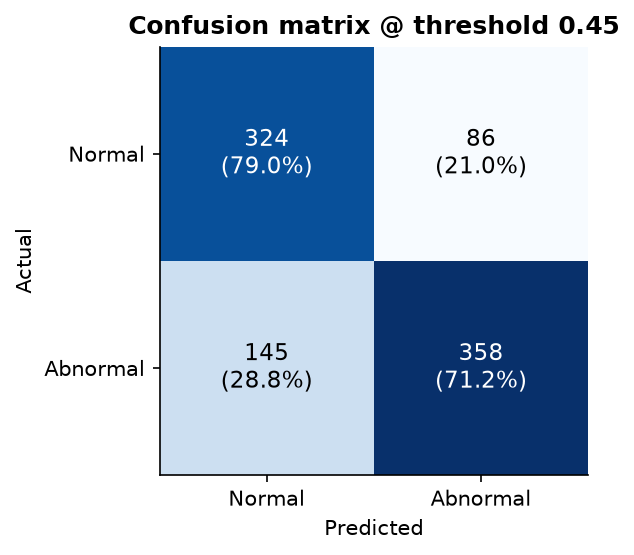
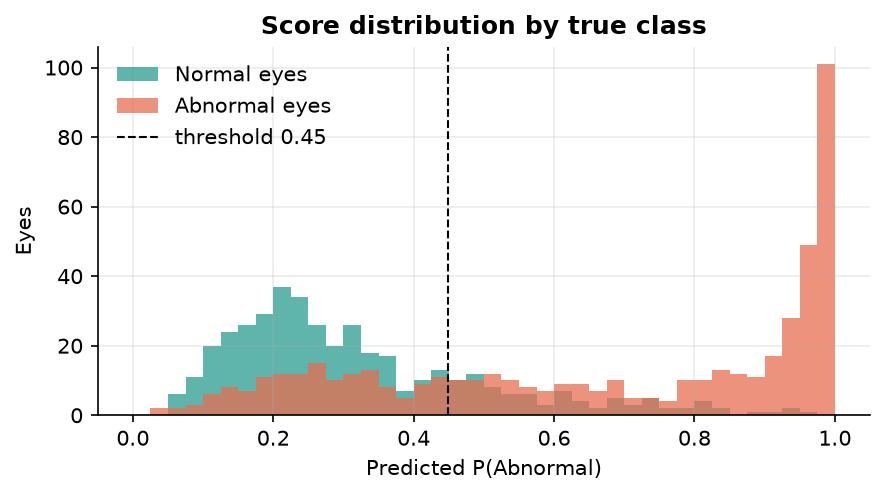
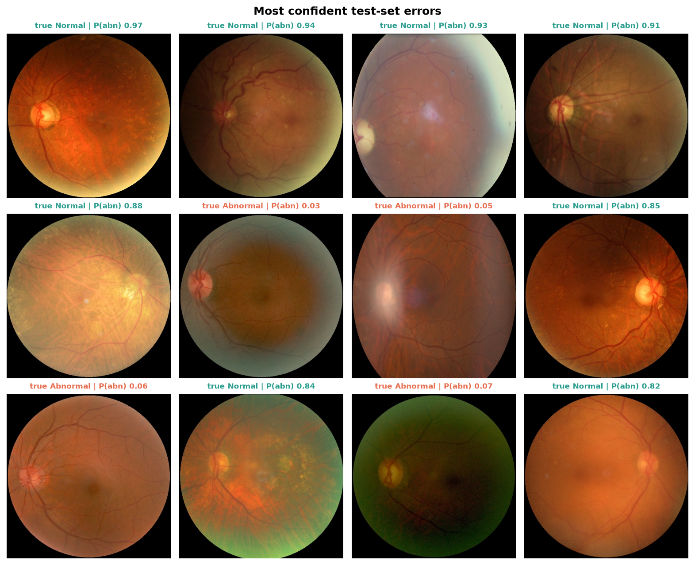
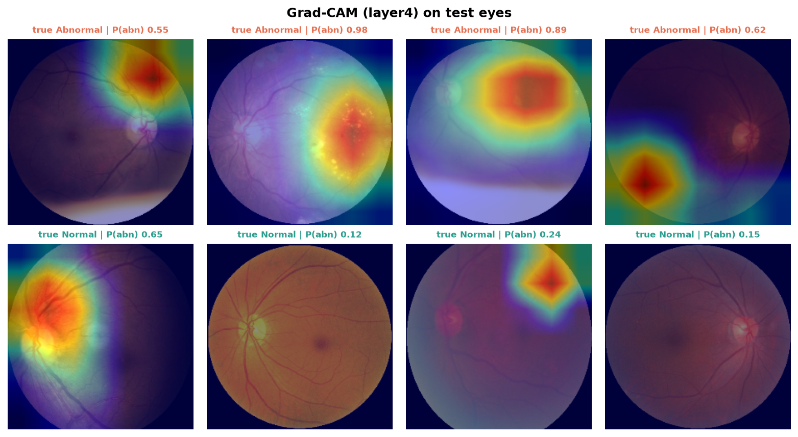

# Model card: Normal vs Abnormal fundus classifier

| | |
|---|---|
| **Task** | Binary screening of a single fundus photograph: *Normal* (0) vs *Abnormal* (1) |
| **Architecture** | ResNet34 backbone (ImageNet-1k weights) + 3-layer MLP head, 1 logit, 21,449,793 parameters |
| **Input** | 224 × 224 RGB, ImageNet normalisation |
| **Training data** | ODIR-5K, 4566 eyes / 2398 patients (55.0 % abnormal) |
| **Validation / test** | 913 / 913 eyes, patient-grouped, class-stratified |
| **Code** | `fundusvision.models.classifier`, `fundusvision.training.classifier`, `fundusvision.evaluation.classifier` |
| **Run artefacts** | `results/classifier/{config,history,metrics}.json`, `split.csv` |

## Labels

An eye is **Normal** only when every meaningful token of its own diagnostic keyword string equals
`normal fundus`; the capture artefacts `lens dust` and `low image quality` are ignored. Anything
else (diabetic retinopathy, glaucoma, cataract, AMD, hypertension, myopia, "other", or an empty
keyword list) is **Abnormal**. See `keyword_to_label` and `tests/test_labels.py`.

## Training recipe

| Setting | Value |
|---|---|
| Loss | `BCEWithLogitsLoss(pos_weight = n_normal / n_abnormal)` computed on the training split |
| Optimiser | AdamW, lr 1e-4, weight decay 1e-4 |
| Schedule | `CosineAnnealingWarmRestarts(T_0=10, T_mult=2, eta_min=1e-6)` |
| Batch size | 16 (`drop_last` on train so BatchNorm never sees a batch of 1) |
| Augmentation (train only) | horizontal flip 0.5, vertical flip 0.2, rotation ±15°, colour jitter (brightness 0.7–1.3, contrast/saturation ±0.2), affine (±10°, 5 % translation, 5° shear), Gaussian blur p=0.3 |
| Early stopping | patience 10 on validation loss, max 50 epochs |
| Selected epoch | 15 of 25 run (validation loss 0.5024) |
| Hardware / time | MPS, 48 min |

## Test-set results

Thresholds are selected on the validation split and applied unchanged to the test split. The
**val max-Youden** row is the headline operating point (balanced sensitivity / specificity); the
max-F1 threshold is shown for completeness but ignores true negatives and therefore sits very low
on this positive-majority data.

| operating point | thr | accuracy | balanced acc. | sensitivity | specificity | precision (PPV) | NPV | F1 | MCC | Cohen's κ | ROC AUC | PR AUC |
|---|---|---|---|---|---|---|---|---|---|---|---|---|
| **default 0.5** | 0.500 | 0.748 | 0.757 | 0.670 | 0.844 | 0.840 | 0.676 | 0.746 | 0.515 | 0.502 | 0.817 | 0.875 |
| **val max-F1** | 0.260 | 0.694 | 0.675 | 0.865 | 0.485 | 0.673 | 0.745 | 0.757 | 0.383 | 0.362 | 0.817 | 0.875 |
| **val max-Youden** | 0.449 | 0.747 | 0.751 | 0.712 | 0.790 | 0.806 | 0.691 | 0.756 | 0.500 | 0.495 | 0.817 | 0.875 |

Confusion counts at the val max-Youden threshold (0.449): TP 358, TN 324, FP 86, FN 145 (n = 913).

Validation split at threshold 0.5 for reference: accuracy 0.687, ROC AUC 0.788.

## Error analysis

The most confident mistakes on the test split. Title colour = true class.

Grad-CAM over `layer4` for correctly classified test eyes:

## Intended use and caveats

* Research / coursework only. Not validated for clinical use.
* The "Abnormal" class pools very different pathologies; a per-disease multi-label model would be
  needed to say *what* is wrong.
* Trained on ODIR-5K only (a handful of Chinese hospitals, one camera family). Expect a domain shift
  on other populations and devices.
* Earlier reported numbers for this project (≈84 % accuracy, 0.91 AUC) came from a split with
  duplicated images leaking between train and test and should not be compared with the table above.
