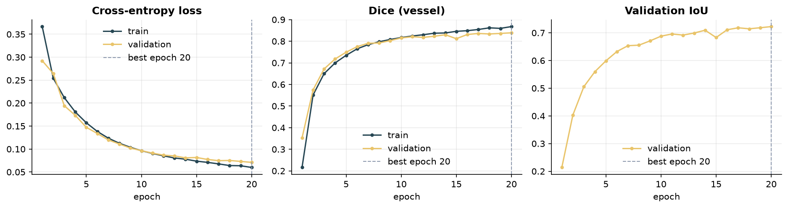

# Model card: retinal vessel segmentation (U-Net)

| | |
|---|---|
| **Task** | Per-pixel binary segmentation of retinal vessels in a fundus photograph |
| **Architecture** | 4-level U-Net, widths 64-128-256-512, 1024-channel bottleneck, transposed-conv decoder, BatchNorm + ReLU double-conv blocks, 1×1 output head; 31,043,586 parameters, trained from scratch |
| **Input / output** | 224 × 224 RGB (ImageNet normalisation) → 224 × 224 × 2 class logits |
| **Training data** | Kaggle fundus vessel segmentation set: 480 train / 120 validation pairs (seeded 80/20 split of the 600 training pairs); images resized with linear interpolation |
| **Test data** | 200 held-out pairs |
| **Code** | `fundusvision.models.unet`, `fundusvision.training.segmentation`, `fundusvision.evaluation.segmentation` |
| **Run artefacts** | `results/segmentation/{config,history,metrics}.json` |

## Training recipe

| Setting | Value |
|---|---|
| Loss | per-pixel cross-entropy (2 classes) |
| Optimiser | Adam, lr 1e-4 |
| Schedule | constant (`--cosine` enables cosine annealing; see ablation) |
| Batch size | 8 |
| Epochs | 20 (best validation Dice kept: epoch 20, Dice 0.839) |
| Augmentation | none (`--augment` enables random flips; see ablation) |
| Masks | grayscale, nearest-neighbour resize, binarised at > 127 |
| Hardware / time | MPS, 21 min |

## Test-set results

Micro-averaged over all test pixels (the convention used in the original notebook), plus the mean
of per-image Dice.

| metric | this run (20 epochs, no augmentation, best val Dice) | project's first report (10 epochs, Colab) |
|---|---|---|
| pixel accuracy | 0.9753 | 0.9758 |
| IoU (vessel) | **0.6932** | 0.7010 |
| Dice (vessel) | **0.8188** | 0.8242 |
| precision (vessel) | 0.8581 | – |
| recall (vessel) | 0.7830 | – |
| mean per-image Dice | 0.8030 | – |

Vessels occupy only ~7 % of the pixels, so pixel accuracy is dominated by background and is quoted
for completeness only; IoU and Dice on the vessel class are the meaningful numbers.

Overlay legend: white = true positive, red = missed vessel pixels, cyan = spurious predictions.

## Ablation: why no augmentation and no cosine schedule

All runs below use the same split, model and loss; only the schedule and augmentation differ.
Test numbers are micro-averaged over the 200 held-out images.

| run | augmentation / schedule | epochs | best val Dice | test Dice | test IoU | test pixel acc. |
|---|---|---|---|---|---|---|
| `segmentation_area` | flips + cosine, area resize | 15 | 0.684 | 0.640 | 0.470 | 0.9545 |
| `segmentation_linear` | flips + cosine | 15 | 0.675 | 0.654 | 0.486 | 0.9546 |
| `segmentation_flips_constlr` | flips, constant LR | 10 | 0.677 | 0.659 | 0.492 | 0.9550 |
| `segmentation_original` | none, constant LR (original recipe) | 10 | 0.815 | 0.794 | 0.659 | 0.9723 |
| `segmentation` | **none, constant LR (final, this run)** | 20 | 0.839 | 0.819 | 0.693 | 0.9753 |

Random flips cost ~0.13 test Dice at 10 epochs: on 480 training images the from-scratch U-Net
converges much faster when it can rely on the fixed fundus geometry (optic-disc side, vessel
arcades), and flipping doubles the geometry it must cover. The cosine schedule, by contrast, is
neutral (runs with flips score the same with or without it). With a larger dataset, longer
training or a pretrained encoder, augmentation would likely pay off again, so both options stay
available on the CLI (`--augment`, `--cosine`).

## Caveats and next steps

* 224 px inputs make capillaries 1–3 px wide; higher resolution or patch-based training would help
  the thin-vessel recall that dominates the error.
* Cross-entropy does not optimise overlap directly; a Dice / Tversky term, elastic augmentation,
  and attention gates on the skip connections are the obvious upgrades.
* The project's first report (10 epochs, best by validation loss, run on Colab) scored
  Dice 0.824 / IoU 0.701 on the same test split; the 10-epoch replica in the ablation table
  reproduces it to within run-to-run noise.
